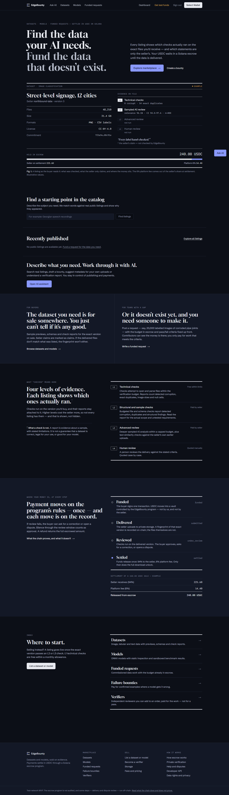
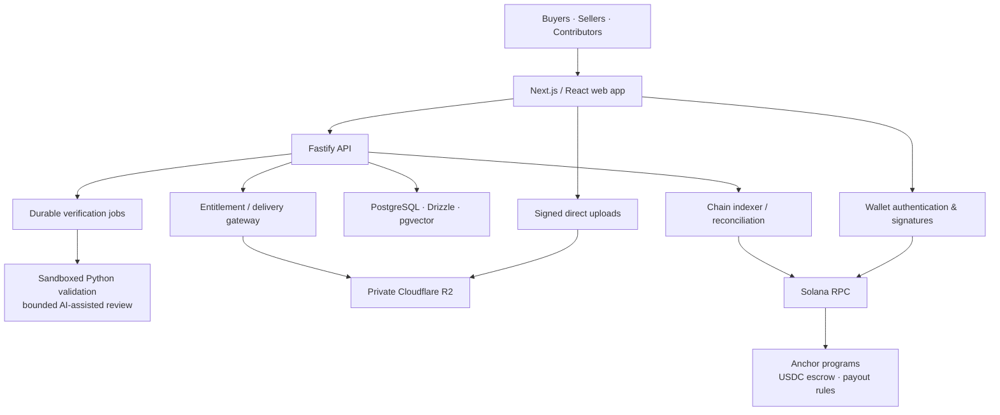

<div align="center">

# EdgeBounty

### The trust and coordination layer for AI data

**Discover data. Coordinate contributors. Verify results. Settle on Solana.**

*Where AI coordinates the work, humans create the value, and Solana secures the trust.*

[](docs/MASTER_IMPLEMENTATION_STATUS.md)
[](docs/PRICING_AND_FEES.md)
[](docs/ARCHITECTURE.md)

[**Live preview**](https://13-61-207-211.sslip.io/) · [Datasets](https://13-61-207-211.sslip.io/datasets) · [Funded requests](https://13-61-207-211.sslip.io/bounties) · [Failure Bounties](https://13-61-207-211.sslip.io/failure-bounties) · [Pricing](https://13-61-207-211.sslip.io/pricing/guide)

</div>

> [!IMPORTANT]
> **Test-network MVP, not a production financial service.** The current deployment uses a **private Solana validator and mock USDC with no monetary value**. It has not been independently audited or deployed with genuine USDC on Mainnet. Features have different readiness levels, clearly described below.

## The problem

AI teams need trustworthy datasets, specialized annotations, independent model evaluations and reliable contributors. Today, sourcing, verification, collaboration and payment are often scattered across disconnected workflows.

**EdgeBounty connects them:** an AI-native marketplace where buyers commission or purchase AI assets, contributors fulfill requests, verification produces inspectable evidence, and Solana smart contracts enforce agreed payment conditions.

## Three-minute judge walkthrough: five contributors, one dataset

**Start with the [recorded live hackathon demo](https://13-61-207-211.sslip.io/#hackathon).** Orbital Vision Lab is a demo company; its buyer and five seller accounts are operated by the project maintainer. They are not independent customers.

1. **0:00 — Inspect the actual files and evidence.** Open the [NASA photo dataset](https://13-61-207-211.sslip.io/listings/31fa1848-5287-49b2-b370-77d65b5c4c54). The recorded run contains six submitted photos, one exact duplicate, and five accepted unique photos. NASA source links and attribution identify the photographs; verification does not establish ownership or prove that an image is not AI-generated.
2. **1:00 — Follow collaboration and AI assistance.** The homepage records the duplicate replacement, accepted contribution totals, and completed NVIDIA assistant/agent responses. The [published evidence snapshot](https://13-61-207-211.sslip.io/hackathon-evidence.json) contains the run identifiers. The [company workspace](https://13-61-207-211.sslip.io/orders/1ddb90e8-cd3d-4cb3-9901-e58a1676f220) requires participant sign-in. Its frozen 500 mock-USDC allocation is accounting evidence; it does not demonstrate completed seller payouts.
3. **2:00 — Inspect models and the purchase flow.** Open the [red/blue ONNX classifier](https://13-61-207-211.sslip.io/listings/a2ace96b-f591-431b-b2b7-f60ad4fe9cac) or [color-dominance baseline](https://13-61-207-211.sslip.io/listings/5f7907af-1a0a-4254-a819-b87841a4a23b). These are small inspection examples, not space-image recognition models. A purchase demonstration requires your own test-wallet session, explicit transaction signatures, checkout payment, and settlement before licensed downloads become available. No private wallet credentials are shared in this README.



*Recorded MVP interface. The live hackathon section and evidence links above contain the contributor demonstration; the screenshot is not proof of a completed purchase.*

### What each AI component actually does

| Component | Responsibility | Human authority |
| --- | --- | --- |
| Marketplace assistant | Catalog suggestions, bounty drafts, owner-authorized metadata suggestions, report explanations | Users review/apply content; the model has no payment-signing tools |
| Contributor agents | Scoped work proposals, duplicate-replacement suggestions, progress coordination | Contributors supply files; buyers approve contributions and sign financial actions |
| Verification AI | Bounded sampled relevance checks with report scope and limitations | A report is evidence, not a guarantee of rights, truth, or downstream model quality |

Assistant responses use schema validation, authorized listing citations, account/global daily caps, and private context consent. Failed attempts still count toward those caps. Users can explicitly resend a failed request after 30 seconds; interrupted server requests become retryable after three minutes. No provider retry runs automatically. These controls do not eliminate hallucinations; review factual statements against the linked reports and source material.

## What makes EdgeBounty different?

| Capability | What it changes | Status |
| --- | --- | --- |
| **AI-native discovery and assistance** | Find published datasets, prepare bounty requirements, draft asset metadata and explain verification reports with human approval | **Implemented** with bounded assistant modes |
| **Collaborative data bounties** | Multiple contributors work toward one accepted-data target with duplicate detection, shared progress and agent proposals | **Opt-in pilot**; disabled by default |
| **Solana-based escrow** | Buyers commit funds before fulfillment; contract rules govern acceptance, settlement, refunds and disputes | **Working on private validator** with mock USDC |
| **Failure Bounties** | Reward reproducible failures against a specified model version, with submission commitments and verifier review | **Experimental**; not a production guarantee |

The key idea: **AI helps coordinate work, people retain authority, and smart contracts secure the financial commitment.**

## A concrete example: 10,000 images, one funded request

An autonomous-driving team needs **10,000 annotated Georgian road-sign images** with a **500 USDC** reward.

1. **Define** — The buyer describes the required labels, quality criteria and budget. The assistant helps draft the request; the buyer approves its terms.
2. **Fund** — The buyer signs a transaction transferring the committed tokens into a program-controlled escrow vault.
3. **Collaborate** — Three contributors provide 4,000, 3,000 and 3,000 candidate images. The shared workspace tracks accepted contributions, duplicates and remaining work.
4. **Verify** — Technical checks and bounded AI-assisted review produce evidence. Humans decide which submissions meet the bounty terms.
5. **Settle** — Authorized wallet signatures and Anchor contract rules release eligible rewards or permit refunds/dispute outcomes.

At a hypothetical full **500 USDC** settlement, **470 USDC** is allocated to contributor proceeds and **30 USDC** is EdgeBounty's **6% marketplace commission**, before separately quoted service costs.

**Important implementation detail:** the current collaborative pilot **does not send three payouts directly from one shared parent escrow**. After human approval, it prepares a frozen allocation and separate designated-contributor contracts; the buyer explicitly signs each funding transaction. See [collaborative bounty settlement](docs/COLLABORATIVE_BOUNTIES.md).

## Failure Bounties: make model weaknesses measurable

EdgeBounty also supports a different kind of challenge: **finding reproducible model failures**.

A model owner defines the target model version, failure criteria, evaluation parameters and reward per valid example. Contributors submit candidate counterexamples. An authorized verifier evaluates the evidence against the committed version; exact duplicate commitments are designed to be rejected by the on-chain workflow.

This turns model evaluation into a structured incentive mechanism, not a claim that any single check proves a model safe or correct.

[Explore Failure Bounties →](https://13-61-207-211.sslip.io/failure-bounties)

## Architecture



**Trust boundaries matter:** files live in private object storage, operational data lives in PostgreSQL, and financial commitments live in Solana programs. The AI layer never holds wallet private keys or independently approves transfers.

### Why Solana?

| Technology | Responsibility inside EdgeBounty |
| --- | --- |
| **USDC / SPL Token** | Price purchases, fund bounties and distribute settled proceeds |
| **Rust + Anchor** | Encode escrow state transitions, authorization, fee splits and refund/dispute pathways |
| **Program-derived addresses (PDAs)** | Give the program authority over escrow vaults, rather than leaving funded rewards spendable by the buyer |
| **Wallet signatures** | Authenticate users and separately authorize funding, acceptance and other financial actions |
| **RPC + indexer** | Read confirmed chain state and reconcile payments and entitlements |
| **SOL** | Cover network transaction and account-creation fees |

Solana's low-fee, fast-confirmation design is a strong fit for repeated small-value purchases, contributor settlements and failure-example rewards. **No production throughput or TPS benchmark is claimed for EdgeBounty.**

## Business model

The business model separates **marketplace economics** from **usage-based infrastructure charges**. Customers review the exact quote before signing.

| Revenue component | Current MVP pricing |
| --- | --- |
| **Marketplace commission** | **6%** of the settled purchase or bounty reward; **94%** goes to the seller/contributor side. No flat or minimum commission |
| **Asset hosting** | **$0.045 per started GiB per 30-day month**, with a **$0.30 minimum per asset/month** |
| **Download capacity** | **$0.15 per started GiB per included copy**, with the access term and allowed copies disclosed in checkout |
| **Verification** | Basic technical checks within published limits; more extensive sampled and human reviews receive separate capped quotes where applicable |
| **Solana network fees** | Paid in SOL to the network; not EdgeBounty revenue |

A buyer is **not charged twice for an already funded hosting interval**. Provider costs and some proposed future AI pricing are not the same as active customer charges.

Download access begins when both settlement and checkout payment are confirmed, rather than when the initial quote is created. Access terms are 1, 3 or 6 months, with respectively 1, 2 or 3 dataset-sized download allowances. Individual files and ZIPs share that allowance. Remaining bytes and extra-credit quotes are visible on the order page; additional capacity requires explicit wallet payment and does not extend the access end date. ZIP preparation failures consume no quota; interrupted ZIP transfers refund the untransferred proportional source-byte equivalent. ZIPs are limited to 2 GiB and two concurrent archive transfers per API process; larger assets use individual-file delivery. These are MVP limits, not large-dataset performance claims.

Hosting checkouts for the same version wait while an overlapping hosting quote is unpaid. The full download term is honored at activation, including settlement delays; any additional interval needed to honor that promise is currently absorbed by the platform. Existing purchased access windows are preserved rather than silently reset.

[Full fees, refunds and service limitations →](docs/PRICING_AND_FEES.md)

## Technology stack

| Layer | Technology |
| --- | --- |
| **Frontend** | Next.js 16, React 19, TypeScript, Tailwind CSS 4 |
| **API & validation** | Node.js, Fastify 5, Zod 4 |
| **Data** | PostgreSQL 17, Drizzle ORM, pgvector; PGlite for local/test scenarios |
| **Blockchain** | Solana, Rust, Anchor, SPL Token, wallet adapters, private validator |
| **Object storage** | Cloudflare R2; signed multipart uploads, private Worker-based downloads; optional S3 compatibility |
| **Verification** | Python validators, isolated workers, deterministic file and duplicate checks, bounded AI review |
| **AI providers** | NVIDIA for MVP assistant/selected review workflows; Gemini adapter available for optional image review, not a blanket claim of live deployment |
| **Operations** | Docker, AWS EC2, Caddy, PM2, monitoring and encrypted backups |

## Try the project

### Hosted preview

**[Open EdgeBounty →](https://13-61-207-211.sslip.io/)**

The hosted preview is a development deployment. Use its test wallet and test funds only. An empty catalog is a legitimate empty state, not a sample of invented listings.

**Suggested judge walkthrough:** inspect a dataset → review its verification evidence → examine a funded request and escrow state → see a mock-USDC purchase/settlement → explore the collaborative pilot and Failure Bounties. Some workflows require a local fixture or wallet session.

### Local development

**Prerequisites:** Node.js **26+**, npm, Python **3.12+**, and Rust / Solana CLI / Anchor tooling for blockchain flows. On Windows, the Solana program build/test scripts use **WSL Ubuntu**. Provider and storage integrations may require private environment configuration.

```bash
git clone https://github.com/RezusDarsus/EdgeBounty.git
cd EdgeBounty
npm install
```

Start the isolated private validator in **terminal 1**:

```bash
bash scripts/localnet-usdc.sh
```

Once it is running, bootstrap mock USDC and start the backend in **terminal 2**:

```bash
npx tsx scripts/usdc-bootstrap.ts
npm run dev:api
```

Start the website in **terminal 3**:

```bash
npm run dev:web
```

Open **http://localhost:3000**. The demo wallet, mock tokens and faucet are for development only. **Never commit wallet secret keys, seed phrases, API credentials or production environment files.**

For a **standalone collaboration demo** that uses synthetic data and transfers no money:

```bash
npm run demo:collaboration -- --serve
```

Then open **http://127.0.0.1:4010**. This loopback fixture demonstrates contributor progress, shortfall resolution and allocation; it is **not** proof of live on-chain multi-recipient settlement.

### Tests

```bash
npm run typecheck
npm test
npm run demo:collaboration
```

Additional chain and end-to-end suites require their documented local-validator, test-token, database and configuration prerequisites. The repository includes local mock-USDC settlement tests, payment-replay checks, private download authorization tests and collaborative-bounty scenarios. Read the [implementation evidence](docs/MASTER_PLAN_IMPLEMENTATION.md) and [collaboration test guide](docs/COLLABORATIVE_BOUNTIES.md) for exact scope and caveats.

## Development status and roadmap

**Implemented / demonstrated in controlled environments**

- Dataset/model marketplace, funded requests and wallet-based authorization.
- Mock-USDC payments, escrow settlement, 6% fee distribution and replay protection on a private validator.
- Private R2 upload/download flows, entitlement checks and bounded verification.
- A permission-limited AI assistant for marketplace discovery, bounty drafting, metadata and report explanations.
- An opt-in collaborative-bounty pilot and Failure Bounty application flows.

**Not yet production-complete**

- Public Devnet and Mainnet launch with genuine USDC.
- Independent smart-contract/security audit and production signer custody.
- Full commercial/legal approval, provider-invoice reconciliation and production incident operations.
- Generalized large-file content verification and broader model-evaluation coverage.
- Broad rollout and hardening of multi-agent collaboration and Failure Bounties.

**Verification reports are bounded evidence, not guarantees** of ownership, data accuracy, lack of malware or downstream model performance. The MVP is not fully trustless: reviewers and private delivery services remain part of the system.

## Project documentation

- [Product rules and limitations](docs/PRODUCT.md)
- [Architecture and trust boundaries](docs/ARCHITECTURE.md)
- [Latest implementation status](docs/MASTER_IMPLEMENTATION_STATUS.md)
- [Master-plan evidence and remaining work](docs/MASTER_PLAN_IMPLEMENTATION.md)
- [Collaborative bounties, agent behavior and settlement](docs/COLLABORATIVE_BOUNTIES.md)
- [Pricing and fees](docs/PRICING_AND_FEES.md)
- [Security threat model](docs/threat-model/threat-model.md)
- [Independent, private developer analytics: activity, registrations, usage and accounting](services/analytics/README.md)

## Maintainer

Built by [**RezusDarsus**](https://github.com/RezusDarsus).

**EdgeBounty is an experimental platform for building a more transparent AI data economy.** For security issues, contact the maintainer privately rather than publishing credentials or exploit details in an issue.
